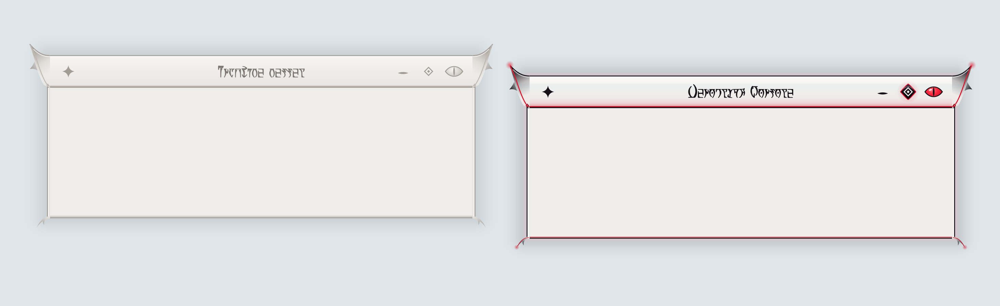
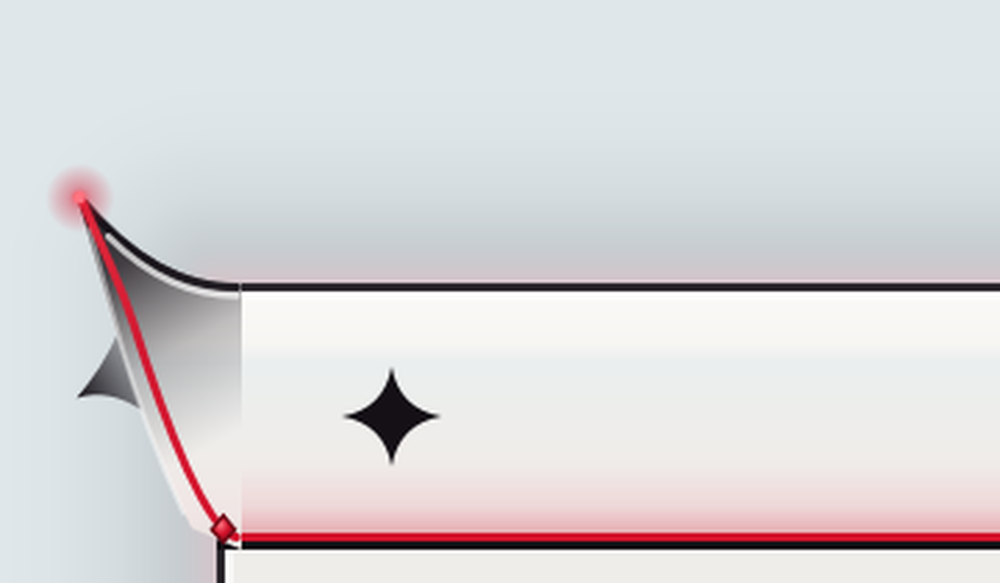
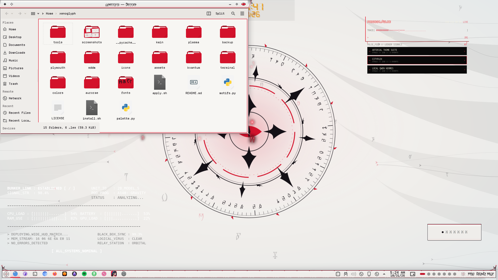

# Xenoglyph — Aurorae Window Decoration

A glossy bone-pearl title plate that flares into barbed tribal fins with glowing ichor tips, thin hooked claws below, and a red-eye close button.



Xenoglyph is an alien-white, cybertribal look for KDE Plasma 6: pearl and bone surfaces, black tribal ink that sweeps into fins, horns and claws, a red ichor seam through everything, Daedric script, and motion everywhere.

## Features

- The plate's ink crown and white bevel run straight on into each fin's upper edge, and the red seam carries on as its vein.
- Each fin is plate-coloured at the root and gathers ink toward the tip. A thorn barb juts from its lower sweep, a carved groove follows that curve, a red ember glows at the tip, and a small gem sits where the fin meets the seam.
- Thin hooked claws with a red vein curl from the bottom corners.
- The close button is a glossy red eye. The other buttons light up as rounded gradient diamonds.
- Window titles in Daedric (OMW Ayembedt, bundled; the installer sets it as the title font).
- Inactive windows fade to bone and ash, and maximised windows drop the fins.





## Requirements

KWin (Plasma 6) with Aurorae.

## Install

```bash
git clone https://github.com/numbpill3d/xenoglyph-aurorae
cd xenoglyph-aurorae && ./install.sh
```

Or from the KDE Store: System Settings → Colors & Themes → Window Decorations → Install from File, or extract to `~/.local/share/aurorae/themes/`. For Daedric titles, install `fonts/OMWAyembedt.otf` and pick it as the window title font.

## The rest of the suite

| piece | repo |
|---|---|
| SDDM login | [xenoglyph-sddm](https://github.com/numbpill3d/xenoglyph-sddm) |
| Plymouth boot splash | [xenoglyph-plymouth](https://github.com/numbpill3d/xenoglyph-plymouth) |
| Global theme + splash screen | [xenoglyph-global](https://github.com/numbpill3d/xenoglyph-global) |
| Plasma style (panel, popups) | [xenoglyph-plasma](https://github.com/numbpill3d/xenoglyph-plasma) |
| Floating runes (KWin script) | [xenoglyph-runes](https://github.com/numbpill3d/xenoglyph-runes) |
| Window open/close animation (KWin effect) | [xenoglyph-unfurl](https://github.com/numbpill3d/xenoglyph-unfurl) |
| Animated + still wallpaper | [xenoglyph-wallpaper](https://github.com/numbpill3d/xenoglyph-wallpaper) |
| Sigil clock widget | [xenoglyph-sigil](https://github.com/numbpill3d/xenoglyph-sigil) |
| Colour scheme | [xenoglyph-colors](https://github.com/numbpill3d/xenoglyph-colors) |
| Kvantum widget style | [xenoglyph-kvantum](https://github.com/numbpill3d/xenoglyph-kvantum) |
| Icon theme | [xenoglyph-icons](https://github.com/numbpill3d/xenoglyph-icons) |
| Konsole + kitty colours | [xenoglyph-konsole](https://github.com/numbpill3d/xenoglyph-konsole) |

Everything at once, with the generators: [xenoglyph](https://github.com/numbpill3d/xenoglyph).

## Tags

`xenoglyph` `kde` `kde-plasma` `plasma6` `light-theme` `white` `red` `cybertribal` `tribal` `alien` `daedric` `otherworldly` `animated` `aurorae` `window-decoration` `kwin` `titlebar` `svg`

## Credits and licence

By splicer scorn (voidrane). GPL-3.0-or-later.
Fonts: OMW Ayembedt (Daedric, SIL OFL 1.1) and Departure Mono by Helena Zhang (SIL OFL 1.1), bundled with their licences.
